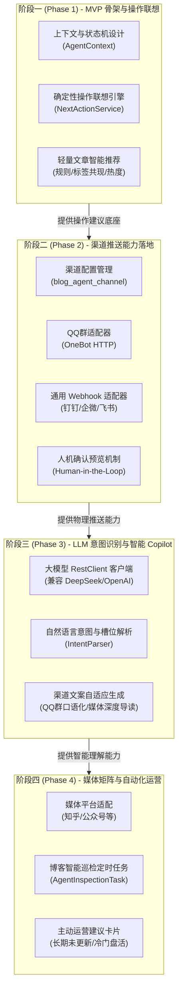

# MyBlog Agent 功能阶段性演进与架构设计规划 (Roadmap)

> **文档定位**：本文档针对博客系统的三大核心诉求（**文章推荐**、**QQ群与媒体推送**、**下一步操作联想与意图识别**），制定分阶段落地实施规划。坚持“**小步快跑、阶段交付、MVP先行**”原则，避免一步到位导致架构过载或效果不佳。

---

## 目录

- [一、 核心理念与技术选型](#一-核心理念与技术选型)
- [二、 整体四阶段演进路线图](#二-整体四阶段演进路线图)
- [三、 阶段一 (Phase 1): MVP - 核心骨架与规则型操作联想](#三-阶段一-phase-1-mvp---核心骨架与规则型操作联想)
- [四、 阶段二 (Phase 2): 触达落地 - QQ群与多渠道推送体系](#四-阶段二-phase-2-触达落地---qq群与多渠道推送体系)
- [五、 阶段三 (Phase 3): 认知升级 - LLM 自然语言意图识别与智能 Copilot](#五-阶段三-phase-3-认知升级---llm-自然语言意图识别与智能-copilot)
- [六、 阶段四 (Phase 4): 自动化闭环 - 媒体平台矩阵与运营主动巡检](#六-阶段四-phase-4-自动化闭环---媒体平台矩阵与运营主动巡检)
- [七、 实体类与数据表映射规范说明](#七-实体类与数据表映射规范说明)
- [八、 阶段实施进度与验收清单](#八-阶段实施进度与验收清单)

---

## 一、 核心理念与技术选型

### 1.1 核心设计理念
1. **确定性优先于随机性**：基础操作联想和业务路由采用“确定性状态机/事件驱动”，保证 100% 稳定可靠；自然语言理解由大语言模型（LLM）负责，负责将模糊意图映射到确定性工具。
2. **轻量闭环，渐进升级**：
   * 初期零外部大模型依赖，在 Spring Boot 3 内部快速闭环骨架；
   * 中期打通物理世界（QQ群、Webhook）交互通路；
   * 后期接入大模型 API 赋能，全面升级为具有思考与推理能力的 Copilot。
3. **架构规范遵守**：严格执行单/多表来源标注、简写类名、无冗余别名、SQL 性能优先、前端按钮文本纯文本无符号（无 Emoji、无箭头、无 `+` 等装饰符号）。

### 1.2 技术栈定位
* **宿主环境**：Spring Boot 3.2.5 + Java 17 + MyBatis-Plus 3.5.5 + MySQL 8.0。
* **外部通信**：Spring Boot 3 原生 `RestClient`（无须引入复杂第三方 SDK，轻量高效）。
* **协议标准**：统一 OpenAI / DeepSeek 兼容标准 API，便于灵活切换云端大模型或本地 Ollama 模型。
* **群聊标准**：OneBot 协议（NapCat / go-cqhttp）与通用 HTTP Webhook。

---

## 二、 整体四阶段演进路线图



---

## 三、 阶段一 (Phase 1): MVP - 核心骨架与规则型操作联想

### 3.1 阶段目标
不引入外部大模型依赖，在 Spring Boot 3 现有架构内建立 Agent 领域模型与基础服务。重点实现：
1. **事件驱动的操作联想机制**：博主在后台完成日常操作后，系统根据事件上下文自动推荐下一步动作。
2. **轻量文章智能推荐接口**：基于文章分类、标签共现与热度加权，提供前台相似推荐与后台盘活推荐。

### 3.2 核心业务流程

```
[博主操作触发] ➔ 保存/发布文章成功 ➔ 携带上下文上下文调用 NextActionService
                                              ↓
[状态机匹配] ➔ 当前事件: ARTICLE_PUBLISHED, 关联数据: articleId = 12
                                              ↓
[生成下一步推荐] ➔ 纯文本无符号操作按钮:
                 1. 按钮: [推送QQ群]       (触发: 阶段二打通的推送动作)
                 2. 按钮: [推荐相关文章]   (触发: 推荐列表抽屉)
                 3. 按钮: [设为置顶]       (触发: 文章置顶接口)
                 4. 按钮: [查看前台]       (触发: 跳转前台详情)
```

### 3.3 详细设计与交付物

#### ① 数据契约（VO / DTO）
* **`AgentSuggestActionVO`**（推荐操作对象）：
  * **计算/逻辑/其他**：
    * `actionCode`：操作类型标识（如 `PUSH_QQ`、`RECOMMEND_RELATED`、`SET_TOP`、`VIEW_PAGE` 等）
    * `label`：前端按钮展示文本（遵循规范：**纯文本无符号**，如 `推送QQ群`、`推荐相关文章`、`设为置顶`、`查看前台`）
    * `description`：推荐理由提示（如 "文章刚发布，建议立即分享到QQ交流群或查看推荐关联文章"）
    * `payload`：携带的动作参数（JSON Object，例如 `{"articleId": 12, "title": "Spring Boot 3 实战"}`）

* **`AgentContextDTO`**（当前操作上下文请求）：
  * **计算/逻辑/其他**：
    * `currentScene`：当前所在页面或事件标识（如 `ARTICLE_EDIT`、`ARTICLE_LIST`、`DASHBOARD`）
    * `targetId`：当前操作的目标实体 ID（如文章 ID）
    * `extraParams`：附加状态（如 `isPublished: true`）

#### ② 核心服务类
* **`NextActionService`**：操作联想核心服务，维护规则状态机映射表。
* **`AgentRecommendService`**：本地轻量推荐算法服务，利用现有的 `BlogArticleMapper` 与 `BlogArticleTagMapper`，单表轻量联合查询，计算相关度最高的前 $N$ 篇文章。
* **`AdminAgentController`**：后台 Agent 控制器，提供联想与推荐接口。

#### ③ 接口清单
| 请求方法 | 路径 | 说明 |
| :--- | :--- | :--- |
| `POST` | `/admin/agent/actions/suggest` | 根据当前上下文获取下一步操作联想列表 |
| `GET` | `/admin/agent/recommend/articles` | 获取与指定文章最相关的推荐文章列表 |
| `GET` | `/agent/recommend/hot` | （前台）获取高热度/推荐文章列表 |

### 3.4 难度与可行性
* **实现难度**：★☆☆☆☆（极低）
* **可行性**：100%，全部复用已有代码和数据表，无外部依赖。
* **预期效果**：博主每次在后台发布或查看文章时，立即获得下一步清晰的操作建议指引。

---

## 四、 阶段二 (Phase 2): 触达落地 - QQ群与多渠道推送体系

### 4.1 阶段目标
让阶段一产生的 `推送QQ群`、`推送媒体渠道` 按钮真正具备物理执行能力：
1. 建立渠道配置中心，支持配置 QQ 群（OneBot / NapCat / Qmsg）及通用 Webhook（钉钉、企业微信、飞书）。
2. 实现文案自动组装与**人机协同预览（Human-in-the-Loop）**，允许管理员在发送前预览或修改文案。
3. 记录推送历史与发送状态。

### 4.2 详细设计与交付物

#### ① 数据库表设计
* **渠道配置表 `blog_agent_channel`**：
  > **单表来源**：`blog_agent_channel`
  * `id`：主键自增 ID
  * `name`：渠道名称（如：`技术交流QQ群`、`开发进度钉钉群`）
  * `channel_type`：渠道类型（`QQ_GROUP`、`DINGTALK`、`WECHAT_WORK`、`CUSTOM_WEBHOOK`）
  * `target_url`：Webhook 完整地址或 OneBot HTTP 接口
  * `secret_token`：加签秘钥或 Bearer 鉴权 Token
  * `enabled`：是否启用（`1-启用`，`0-禁用`）
  * `create_time` / `update_time`：时间戳

* **推送记录表 `blog_agent_push_log`**：
  > **单表来源**：`blog_agent_push_log`
  * `id`：主键 ID
  * `article_id`：推送的文章 ID
  * `channel_id`：目标渠道 ID
  * `push_content`：实际推送的文案内容
  * `status`：推送结果（`1-成功`，`0-失败`）
  * `error_msg`：失败错误信息
  * `create_time`：推送时间

#### ② 核心服务与类设计
* **`PushChannelAdapter` 接口**：定义通用推送行为 `boolean send(BlogAgentChannel channel, PushPayload payload)`。
  * **`QqPushAdapter`**：组装 OneBot 标准格式（CQ 码或富文本），向 NapCat/go-cqhttp 实例发送群消息。
  * **`WebhookPushAdapter`**：组装通用 Markdown/Text 载荷，向钉钉/企业微信/飞书发送机器人通知。
* **`AgentPushService`**：渠道调度中枢，提供文案初稿生成、渠道分发和日志持久化。

#### ③ 接口清单
| 请求方法 | 路径 | 说明 |
| :--- | :--- | :--- |
| `GET` | `/admin/agent/channels` | 查询所有启用的推送渠道列表 |
| `POST` | `/admin/agent/channels` | 新增/修改推送渠道配置 |
| `POST` | `/admin/agent/push/preview` | 生成指定文章在特定渠道的文案预览 |
| `POST` | `/admin/agent/push/execute` | 确认执行推送（触发网络发送并写日志） |
| `GET` | `/admin/agent/push/logs` | 分页查看历史推送记录 |

### 4.3 难度与可行性
* **实现难度**：★★☆☆☆（低）
* **可行性**：95%，标准 HTTP 调用，配合本地已部署的 NapCat/OneBot 或机器人 Webhook 即可畅通运行。
* **预期效果**：博主写完文章后，点击操作联想里的 `推送QQ群`，弹窗展示自动生成的导读文案，点击 `确认推送` 即秒级发送到交流群中。

---

## 五、 阶段三 (Phase 3): 认知升级 - LLM 自然语言意图识别与智能 Copilot

### 5.1 阶段目标
将 Agent 从“按预设规则推荐”升级为“**理解博主的自然语言意图并生成动态操作**”：
1. 接入兼容 OpenAI 协议的大语言模型（如 DeepSeek V3/R1、通义千问或本地 Ollama）。
2. 构建自然语言意图识别器（`IntentRecognizer`），能够识别博主的指令（如“把上周写的 Vue3 文章发到群里”、“帮我推荐两篇 SpringBoot 进阶文章”），解析出对应的动作与参数槽位。
3. 利用 LLM 为不同渠道自动量身定制文案（QQ 群口语活泼风 vs 媒体严肃深度风）。

### 5.2 核心业务流程

```
[博主在对话窗输入] ➔ "把最近阅读量最高的那篇微服务文章推送到技术交流QQ群"
                                              ↓
[LLM 意图识别] ➔ 调用标准 Prompt / Function Calling
                 解析结果 JSON:
                 {
                   "intent": "PUSH_ARTICLE",
                   "slot": { "category": "微服务", "sortBy": "VIEW_COUNT", "target": "QQ_GROUP" },
                   "confidence": 0.96
                 }
                                              ↓
[Agent 意图执行与卡片装配] ➔ 查询数据库命中文章: 《Spring Cloud 微服务最佳实践》
                                              ↓
[生成智能回复与操作卡片] ➔ 回复: "已为您找到阅读量最高(3420次)的微服务文章，建议操作："
                          按钮1: [确认推送]
                          按钮2: [查看文案预览]
                          按钮3: [更换文章]
```

### 5.3 详细设计与交付物
* **`LlmClient`**：基于 Spring Boot 3 `RestClient` 封装的轻量化 LLM 调用类，从 `application.yml` 或 `BlogConfig` 动态读取 `apiKey`、`baseUrl`、`model`。
* **`AgentIntentService`**：意图路由与槽位填充服务，维护 Intent 枚举与系统工具映射。
* **`AdminAgentChatController`**：提供对话交互流式或卡片响应接口。

### 5.4 难度与可行性
* **实现难度**：★★★☆☆（中）
* **可行性**：90%，由于 DeepSeek、通义千问等国内 API 调用成本极低且接口高度统一，接入成本和开发周期均可控。
* **预期效果**：博主只需在博客后台对话框中打字，系统即可听懂指令并直接将执行按钮呈现于眼前。

---

## 六、 阶段四 (Phase 4): 自动化闭环 - 媒体平台矩阵与运营主动巡检

### 6.1 阶段目标
1. 拓展媒体渠道（知乎专栏、微信公众号草稿箱、掘金等平台的开放接口对接或排版导出）。
2. 引入后台**主动巡检机制（Agent Proactive Inspector）**：不仅在博主操作后联想，更能定期自动分析博客数据，主动向博主提建议（如“发现分类【分布式系统】已超过 60 天未更新，建议发布新文章或复活推荐历史文章”）。

### 6.2 详细设计与交付物
* **`AgentInspectionTask`**：基于 Spring `@Scheduled` 的定时巡检服务。
* **`MediaSyncAdapter`**：多媒体平台 API 适配。
* **`DashboardStatsVO` 联动**：在管理员进入后台仪表盘时，直接展示 Agent 的主动洞察与建议。

---

## 七、 实体类与数据表映射规范说明

在实现过程中，严格遵循全局开发规范：

### 1. 单表来源实体标注
* **`BlogAgentChannel`**：标注 `@TableName("blog_agent_channel")`，单表对应渠道配置。
* **`BlogAgentPushLog`**：标注 `@TableName("blog_agent_push_log")`，单表对应推送记录。

### 2. 多表/计算来源 VO / DTO 标注
* **`AgentSuggestActionVO`**：
  > **计算/逻辑/其他**：`actionCode`（操作指令码）、`label`（纯文本按钮名）、`description`（联想理由）、`payload`（携带参数）。
* **`AgentChatResponseVO`**：
  > **计算/逻辑/其他**：`reply`（Agent 回复文本）、`intent`（识别出的意图）、`suggestActions`（下一步操作建议列表）。

### 3. 前端按钮规范强调
* 所有返回前端的按钮文本一律**纯文本、无装饰符号、无 Emoji、无箭头**：
  - 正确：`推送QQ群`、`推荐相关文章`、`确认推送`、`设为置顶`、`查看前台`、`重新生成`
  - 禁止：`+ 推送QQ群`、`推送QQ群 ↗`、`🚀 确认推送`、`🔍 推荐相关文章`

---

## 八、 阶段实施进度与验收清单

| 阶段 | 核心任务目标 | 核心输出 | 状态 |
| :--- | :--- | :--- | :---: |
| **阶段一 (MVP)** | 核心模型 + 规则型下一步操作联想引擎 + 轻量文章推荐 | `AgentSuggestActionVO`, `NextActionService`, `AdminAgentController`, 单元测试 | **待启动** |
| **阶段二** | 渠道配置管理 + QQ群/Webhook 真实推送 + 人机确认机制 | `blog_agent_channel`, `QqPushAdapter`, `AgentPushService` | 待启动 |
| **阶段三** | 接入大模型 API + 自然语言意图识别 + 智能 Copilot 对话 | `LlmClient`, `IntentRecognizer`, 渠道文案自动提炼 | 待启动 |
| **阶段四** | 跨媒体平台扩展 + 后台主动巡检与经营决策推荐 | `AgentInspectionTask`, 知乎/媒体接口, 仪表盘主动提示 | 待启动 |

---
*本文档由 Antigravity 协助生成，作为博客系统 Agent 模块开发的权威指导标准。*
